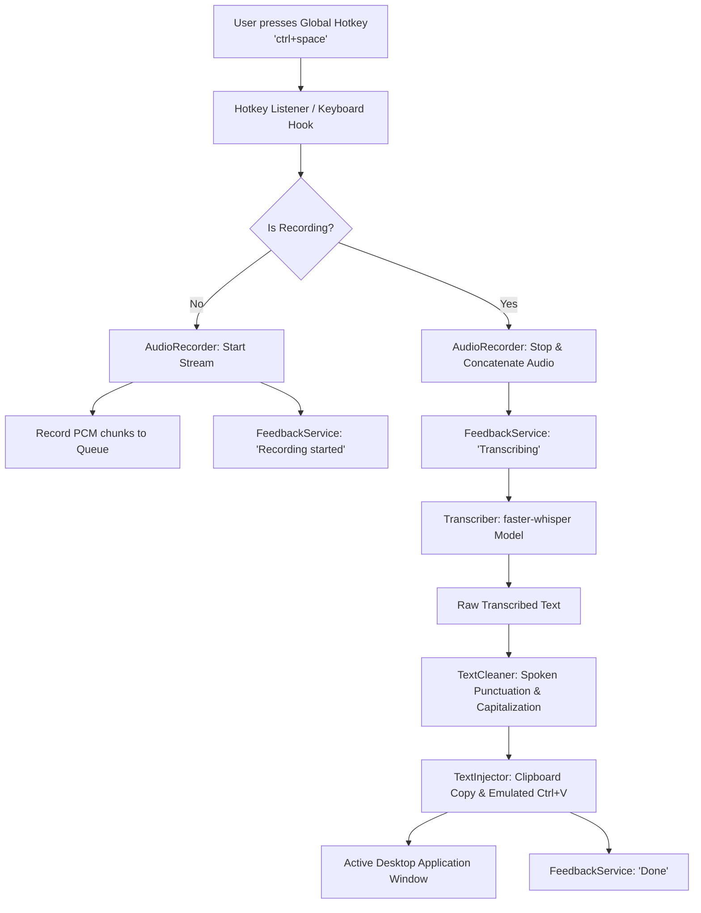

# DhwaniLekh Architecture & System Design

This document details the internal design, component relationships, data flow, and runtime mechanics of **DhwaniLekh**.

---

## 1. High-Level Architecture

DhwaniLekh is architected around an event-driven, decoupled pipeline designed for minimal latency and reliable cross-application text delivery.

---

## 2. Core Modules

All business logic lives inside `src/dhwanilekh/`:

| Module | Class | Responsibility |
|---|---|---|
| `config.py` | `Config` | Loads defaults, parses and saves user options in `settings.json`. |
| `audio.py` | `AudioRecorder` | Non-blocking microphone capture via `sounddevice` into float32 numpy buffers. |
| `transcriber.py` | `Transcriber` | Manages `faster-whisper` WhisperModel, device mapping, and VAD segmentation. |
| `cleaner.py` | `TextCleaner` | Regex-based normalization: translates spoken punctuation phrases ("comma", "new line") and fixes casing. |
| `injector.py` | `TextInjector` | Injects resulting text into active app using clipboard paste or keystroke simulation. |
| `feedback.py` | `FeedbackService` | User notifications via console output and optional text-to-speech audio alerts. |
| `app.py` | `DhwaniLekhApp` | Main application coordinator managing threads, hotkey triggers, and lifecycle. |

---

## 3. Data Flow & Latency Considerations

### 3.1 Audio Ingestion
- Audio input is streamed from the default input device at 16,000 Hz (the native sample rate expected by Whisper models).
- The recording loop runs on a daemon background thread feeding a thread-safe `queue.Queue`.
- No intermediate disk writes occur during active recording; the WAV file is only written upon recording completion to facilitate faster-whisper ingestion.

### 3.2 Speech-to-Text Inference
- Powered by `faster-whisper`, a CTranslate2 re-implementation of OpenAI Whisper.
- Supports model quantization (`int8`, `float16`) to run efficiently on modest CPU hardware without requiring dedicated GPUs.
- Utilizes Voice Activity Detection (VAD) filtering (`vad_filter=True`) to suppress silence and background noise.

### 3.3 Text Post-Processing
- Rule-based regex translation transforms verbal commands into standard typography.
- Trims trailing spaces around punctuation and guarantees proper capitalisation at the start of sentences and newlines.

### 3.4 Text Injection
- **Clipboard Mode (Default)**: Writes the string to the OS clipboard via `pyperclip` and triggers an emulated `Ctrl+V` key combination via `pyautogui`. This is fast, supports large blocks of text instantly, and is fully Unicode-safe.
- **Typing Mode**: Simulates character-by-character typing using `pyautogui.write()`. Slower, but useful for applications or terminals that block programmatic clipboard pastes.

---

## 4. Cross-Platform Strategy & Future Work

While the initial MVP targets Windows desktop environments, the core architecture is designed to support Linux and macOS:

- **Linux**: Replacing `keyboard` hooks with global input daemons or Wayland/evdev hooks; replacing `pyautogui` paste with `wl-copy`/`xdotool`.
- **macOS**: Utilizing Accessibility APIs and AppleScript for injection.
- **Streaming Audio**: Transitioning from batch chunking to streaming VAD chunks for real-time transcription displays.

